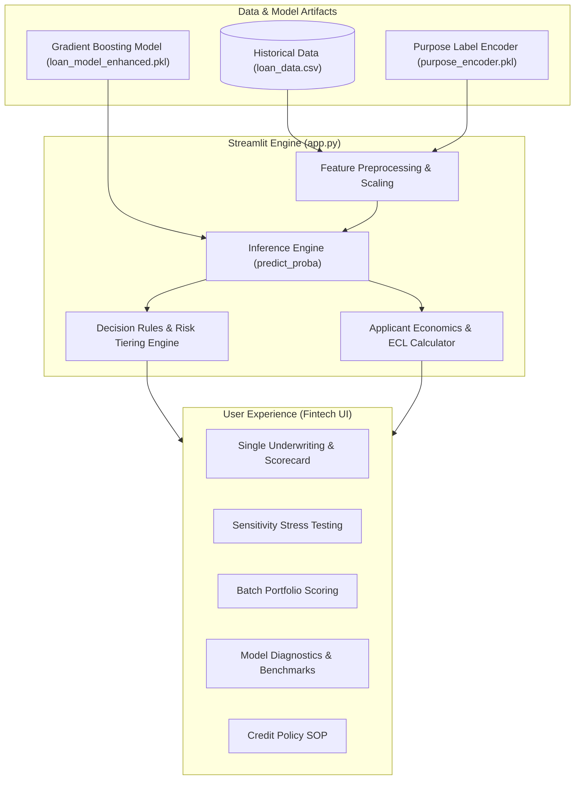

# 💳 FinRisk IQ — Intelligent Credit Underwriting & Loan Repayment Predictor

[](https://streamlit.io/)
[](https://www.python.org/)
[](https://scikit-learn.org/)
[](https://plotly.com/)
[](https://opensource.org/licenses/MIT)

> **FinRisk IQ** is an end-to-end fintech credit decisioning and loan repayment probability forecasting platform. Powered by an ensemble **Gradient Boosting** machine learning pipeline and a **Streamlit** dashboard, it automates credit scorecard generation, portfolio stress testing, batch underwriting, and regulatory compliance reporting.

---

## 📌 Table of Contents
- [Executive Overview](#-executive-overview)
- [Key Features](#-key-features)
- [System Architecture](#-system-architecture)
- [Machine Learning Pipeline](#-machine-learning-pipeline)
- [Dataset & Feature Specification](#-dataset--feature-specification)
- [Project Structure](#-project-structure)
- [Installation & Quickstart](#-installation--quickstart)
- [Usage Walkthrough](#-usage-walkthrough)
- [Regulatory & Compliance Framework](#-regulatory--compliance-framework)
- [License & Acknowledgments](#-license--acknowledgments)

---

## 🚀 Executive Overview

Retail lending and credit underwriting require balancing rapid decision-making with rigorous risk management. **FinRisk IQ** bridges raw financial data and actionable credit decisions by:
1. **Predicting Probability of Default (PD)** and **Probability of Full Repayment** for loan applications in milliseconds.
2. **Assigning Dynamic Risk Tiers (A through E)** based on institutional credit risk thresholds.
3. **Explaining Key Risk Drivers** to satisfy adverse action notification requirements under the **Fair Credit Reporting Act (FCRA)**.
4. **Simulating Economic Shock Scenarios** (sensitivity curves for FICO score, DTI ratio, and interest rate spikes).
5. **Evaluating Portfolio-Wide Batches** with aggregate Expected Credit Loss (ECL) calculation and automated audit reports.

---

## ✨ Key Features

### 1. 👤 Single Applicant Underwriting & Scorecard
- **1-Click Underwriting Presets**: Instant loading for standard profiles (*Tier A: Super-Prime Executive*, *Tier B: Prime Homeowner*, *Tier C: Near-Prime Business*, and *Tier D: Subprime Stressed*).
- **Interactive Risk Scorecard**: Real-time gauge visualization showing **PD (%)** vs. **Repayment Probability (%)**.
- **Financial Return Metrics**: Computes Expected Credit Loss (ECL), Monthly Payment burdens, and Risk-Adjusted Return.
- **Factor Attribution Engine**: Lists primary positive mitigating factors and negative risk drivers.

### 2. 🧪 What-If Sensitivity Simulator
- Stress-test borrower profiles against macroeconomic shifts.
- Dynamic sensitivity graphs showing default risk elasticity across **FICO scores**, **Debt-to-Income (DTI)**, and **Interest Rate** fluctuations.

### 3. 📁 Batch Portfolio Underwriting
- Ingest multi-row credit applicant files via CSV upload or pre-loaded benchmarks (`sample_loan_applicants.csv`).
- Automated mass scoring, risk-tier grouping, total portfolio exposure calculations, and one-click export of scored audit files.

### 4. 📊 Model Benchmark & Analytics Lab
- Diagnostic inspection comparing live applicant inputs against the historical baseline distribution (`loan_data.csv`).
- Feature importance visualization highlighting the strongest predictors of default.

### 5. 📘 Credit Policy & Rules SOP
- Codified underwriting policy rules and cutoffs (Tier A Prime through Tier E Decline).
- Compliance adherence guidelines for **FCRA**, **Equal Credit Opportunity Act (ECOA / Reg B)**, and **Basel II/III** risk management standards.

---

## 🏗️ System Architecture



---

## 🧠 Machine Learning Pipeline

- **Algorithm**: Gradient Boosting Classifier (`sklearn.ensemble.GradientBoostingClassifier`)
- **Objective Function**: Binary Cross-Entropy Loss / Deviance (`not.fully.paid`: 0 = Paid in Full, 1 = Defaulted)
- **Hyperparameters**:
  - `learning_rate`: `0.04`
  - `n_estimators`: `140`
  - `subsample`: `0.85`
  - `random_state`: `42`
- **Model Evaluation**:
  - **Baseline Accuracy**: ~84.7%
  - **ROC-AUC**: ~0.710
  - Calibrated probability outputs for nuanced risk-tier segmentation.

---

## 📊 Dataset & Feature Specification

Trained on historical borrower data with 9,578 records across 13 core credit parameters:

| Feature Name | Description | Type |
| :--- | :--- | :--- |
| `credit.policy` | 1 if applicant meets underwriting criteria, 0 otherwise | Binary |
| `purpose` | Loan purpose (`credit_card`, `debt_consolidation`, `small_business`, etc.) | Categorical |
| `int.rate` | Proportionate annual interest rate (e.g. 0.125 = 12.5%) | Float |
| `installment` | Monthly installment owed if the loan is approved | Float |
| `log.annual.inc`| Natural log of borrower self-reported annual income | Float |
| `dti` | Debt-to-Income ratio (debt obligations / annual income) | Float |
| `fico` | FICO credit score (range: 300 – 850) | Integer |
| `days.with.cr.line` | Days borrower has held an open credit line | Float |
| `revol.bal` | Revolving balance remaining unpaid at cycle close | Float |
| `revol.util` | Revolving credit line utilization percentage | Float |
| `inq.last.6mths` | Number of formal credit inquiries in the past 6 months | Integer |
| `delinq.2yrs` | Number of 30+ day delinquencies in the past 2 years | Integer |
| `pub.rec` | Derogatory public records (bankruptcies, liens, judgements) | Integer |

---

## 📂 Project Structure

```bash
Loan_Repayment_Prediction/
├── app.py                         # Main Streamlit web application & UI engine
├── requirements.txt               # Production dependencies
├── .gitignore                     # Git ignore rules (cache, venv, checkpoints)
├── loan_model_enhanced.pkl        # Trained production Gradient Boosting model
├── loan_model.pkl                 # Baseline model artifact
├── purpose_encoder.pkl            # Scikit-learn LabelEncoder for loan purpose
├── loan_data.csv                  # Reference LendingClub benchmark dataset
├── sample_loan_applicants.csv     # Sample applicant batch for 1-click testing
├── Loan_Repayment_Prediction.ipynb # Jupyter notebook with EDA, training & evaluation
└── README.md                      # Comprehensive project documentation
```

---

## ⚡ Installation & Quickstart

### Prerequisites
- **Python 3.10+** (Tested on Python 3.11)
- Git

### 1. Clone the Repository
```bash
git clone https://github.com/<YOUR_USERNAME>/Loan_Repayment_Prediction.git
cd Loan_Repayment_Prediction
```

### 2. (Recommended) Create a Virtual Environment
```bash
# Windows
python -m venv venv
venv\Scripts\activate

# macOS / Linux
python3 -m venv venv
source venv/bin/activate
```

### 3. Install Dependencies
```bash
pip install -r requirements.txt
```

### 4. Run the Streamlit Application
```bash
streamlit run app.py
```
> The dashboard will automatically launch in your browser at `http://localhost:8501`.

---

## 💡 Usage Walkthrough

1. **Underwrite an Individual**: Navigate to the **Single Underwriting** tab, pick a preset button (e.g. *Tier A: Super-Prime Executive*) or adjust applicant parameters in the left panel, then view instantaneous default probability, approval tier, and credit recommendations.
2. **Conduct Stress Testing**: Switch to the **What-If Sensitivity Simulator** tab to analyze how rising interest rates or worsening DTI ratios shift the applicant from *Approve* to *Decline*.
3. **Execute Batch Operations**: In the **Batch Portfolio Underwriting** tab, drag and drop `sample_loan_applicants.csv` to process credit applications en masse and export the scored CSV.
4. **Review Compliance**: Check the **Credit Policy SOP** tab for audit guidelines and regulatory adverse action justification standards.

---

## ⚖️ Regulatory & Compliance Framework

FinRisk IQ is engineered with consumer credit protection standards:
- **FCRA (Fair Credit Reporting Act)**: Generates deterministic adverse action explanations when an application triggers conditional review or rejection.
- **ECOA (Equal Credit Opportunity Act / Regulation B)**: Prohibits the use of protected class variables (race, color, religion, national origin, sex, marital status, age). The model relies strictly on financial capacity and credit history indicators.
- **Basel Framework Alignment**: Employs industry-standard **Probability of Default (PD)** and **Expected Credit Loss (ECL)** paradigms for sound risk governance.

---

## 📄 License

Distributed under the **MIT License**. See `LICENSE` for more information.

---

<p align="center">
  <b>Developed for Intelligent Credit Analytics & Underwriting Innovation</b>
</p>
